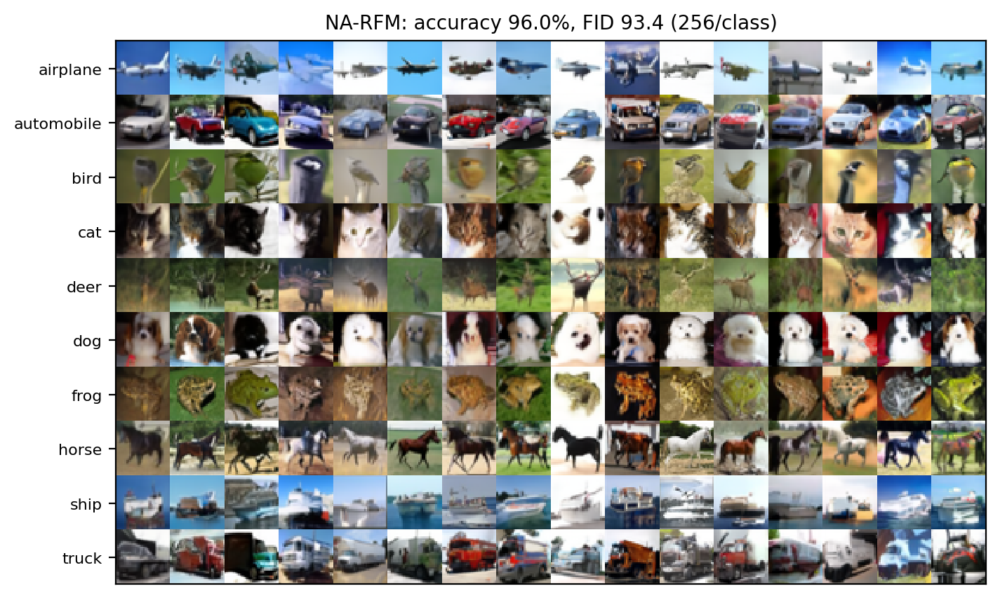
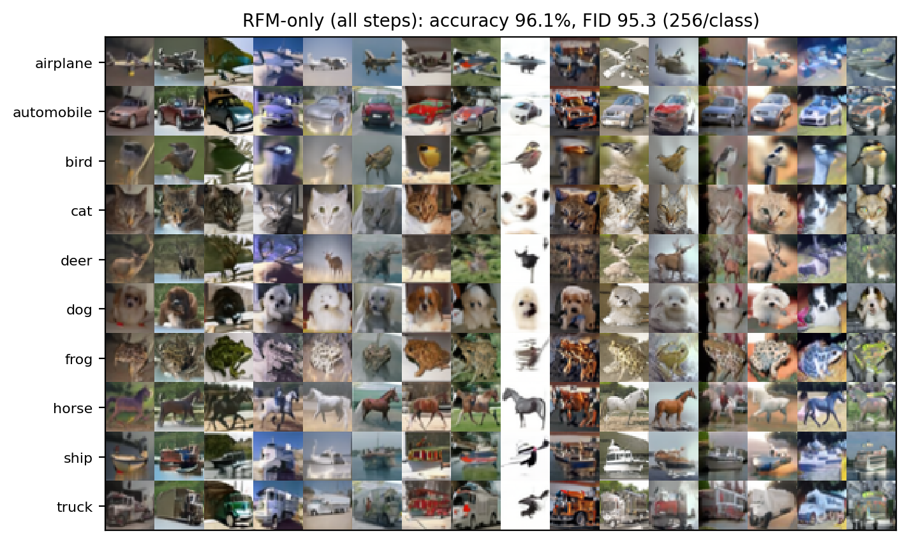
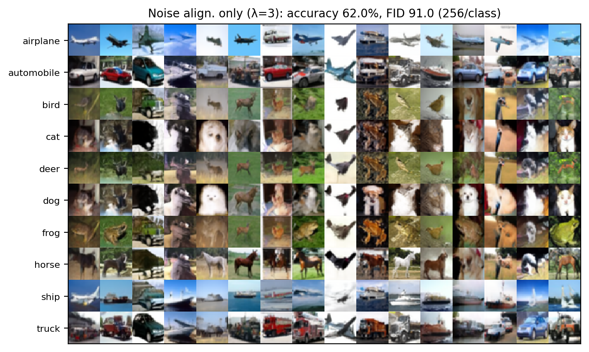
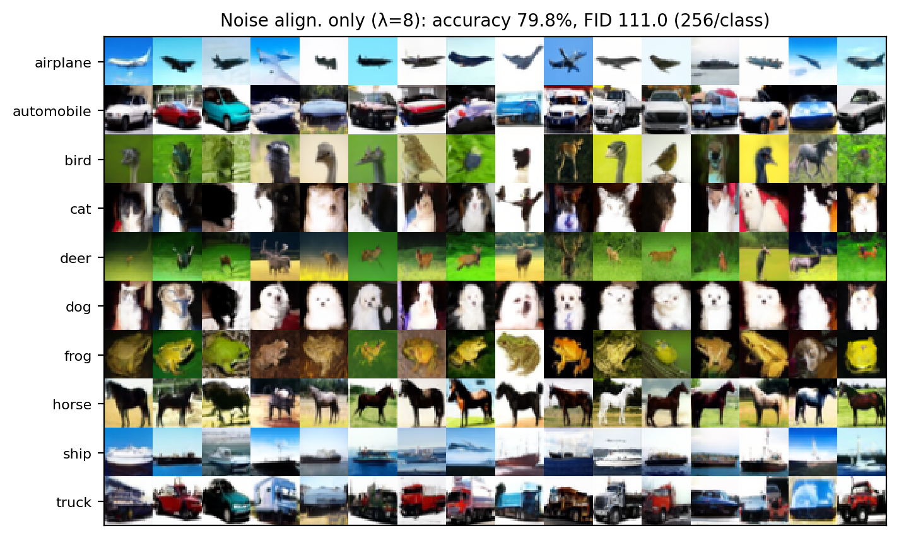

# Replicating NA-RFM's CIFAR-10 experiment (Table 2)

DSC 180A, section D32, Fall 2026 · mentor: Yusu Wang

This repository reproduces Table 2 of Wang, Belkin and Wang, *General and Efficient Steering of Diffusion Models* (ICML 2026, [arXiv 2602.11395](https://arxiv.org/abs/2602.11395)) with the paper's public code, [isotrivial/na-rfm](https://github.com/isotrivial/na-rfm). It is part 4 of the Nov 4 assignment.

The method steers a pretrained, unconditional CIFAR-10 diffusion model toward a class without retraining it:
- **noise alignment (NA)**, in the early, high-noise steps: the CFG recipe with two Gaussian denoisers, one for the class and one for all images;
- **RFM steering**, in the later steps: features of one network block are pushed along a class direction $v_{\text{RFM}}$ learned with Recursive Feature Machines, then the CFG recipe is applied again.

## Results

256 images per class, seeds 0 to 255, 100 DDIM steps, on a Colab T4. Accuracy is from the paper's evaluator (ConvNeXt-Tiny fine-tuned on CIFAR-10). FID is computed per class against that class's 6,000 CIFAR-10 images, then averaged over the ten classes.

| Setting | Accuracy, ours | Accuracy, paper | FID, ours (256/class) | FID, paper (2,048/class) | Time, ours (s/image, batch 64, T4) | Time, paper (s/batch of 16, A100) |
|---|---|---|---|---|---|---|
| Unguided | 10.0% | – | 157.8 | – | 0.68 | – |
| Noise alignment only, λ = 3 | 62.0% | 62% | 91.0 | 99 | 0.40 | 5.8 |
| Noise alignment only, λ = 8 | 79.8% | 80% | 111.0 | 120 | 0.41 | 5.8 |
| RFM only (all steps) | 96.1% | 94.8% | 95.3 | 40.3 | 0.80 | 6.8 |
| NA-RFM | 96.0% | 96.6% | 93.4 | 41.4 | 0.68 | 6.2 |

- **Accuracy matches Table 2 closely.** At 256 images per class the paper reports 94.3% for RFM only (Figure 8) and 97.9% for NA-RFM (Figure 7).
- **Our FIDs for the RFM settings are much higher than Table 2's** because we used 256 images per class rather than 2,048, and FID is biased upward for small samples. Compare settings with each other, not with the paper's FIDs.
- **Times are not comparable with the paper's** (different GPU and batch size); compare settings with each other.

The report discusses each difference. Per-class numbers are in [`results/per_class_acc_fid.csv`](results/per_class_acc_fid.csv) and each class's RFM AUC in [`results/rfm_auc.csv`](results/rfm_auc.csv).

| | |
|---|---|
|  |  |
|  |  |

## How to rerun

Everything is in one notebook, [`notebooks/narfm_cifar10_replication.ipynb`](notebooks/narfm_cifar10_replication.ipynb), built on the course's starter notebook. Sections 0 to 4 are the starter's, for one class (cars); section 5 (Parts A to D) extends it to all ten classes and the five settings.

1. Open it in Colab: [](https://colab.research.google.com/github/andrewyounucsd/dsc180a-narfm-replication/blob/main/notebooks/narfm_cifar10_replication.ipynb)
2. Runtime → Change runtime type → **T4 GPU** (any CUDA GPU works).
3. Run the cells from top to bottom. The notebook mounts Google Drive and saves everything to `MyDrive/dsc180_narfm/`. Each expensive step skips work already saved there, so after a disconnect, rerun the setup cells and continue.

Total time on a T4: about 30 minutes for sections 0 to 4, about 30 minutes for Part A, about 3 hours for Part B, and about 10 minutes for Parts C and D.

### Software and fixed versions

The setup cell installs everything:

| Component | Version |
|---|---|
| na-rfm (the paper's code) | commit [`8e9619b`](https://github.com/isotrivial/na-rfm/tree/8e9619bc6735b03d73056bfdc13dd3659b96e127) |
| Training-Free-Guidance (TFG), which na-rfm builds on, cloned into `na-rfm/baselines/tfg` | commit [`f8d17f3`](https://github.com/YWolfeee/Training-Free-Guidance/tree/f8d17f3ec2f0e7377dedf7b7bc62fad15f36cb77) |
| Python packages | `datasets scikit-learn scipy transformers gdown pandas`, plus Colab's PyTorch |

**Two code fixes** for current library versions, both applied by the setup cell:
1. `repro/evaluate_saved_samples.py` loads CIFAR-10 from Hugging Face as `"cifar10"`, which current `datasets` rejects. The fix uses its current name, `"uoft-cs/cifar10"`.
2. TFG's `evaluations/utils/torch_sqrtm.py` imports `scipy.linalg._matfuncs_sqrtm_triu`, which fails in SciPy 1.16 unless `scipy.linalg._matfuncs_sqrtm` is imported first. The fix adds that import.

### Data and model

Both are downloaded by the notebook (about 700 MB in total):
- **CIFAR-10** from Hugging Face, [`uoft-cs/cifar10`](https://huggingface.co/datasets/uoft-cs/cifar10). The training images are written to one folder per class for the PCA script.
- **The diffusion model** is OpenAI's improved-DDPM U-Net for CIFAR-10, the file `openai_cifar10.pt` (210 MB) that TFG distributes. It is downloaded with `gdown` from TFG's Google Drive (file id `1eInndCjx389Tl45kfmntVo23f_-82bHl`) into `na-rfm/data/checkpoints/` and checked against MD5 `2754c3e3c778ef6e0ab98e8aacaefaf9`. If `gdown` is rate-limited, download it by hand from TFG's shared folder into that path.
- **The evaluator** is `ConvNeXt-Tiny` fine-tuned on CIFAR-10, downloaded from Hugging Face by na-rfm's scripts.

## What produces each table and figure

Cells are in the notebook's section 5. The outputs are saved to `MyDrive/dsc180_narfm/` and copied into this repository.

| Output | In this repo | Notebook cell |
|---|---|---|
| Gaussian denoisers for all ten classes (PCA, 1,000 directions of each class's 5,000 images) | not committed (large); rebuilt by the notebook | Section 1, then Part A, first cell |
| RFM directions for all ten classes, with each class's AUC | [`results/rfm_auc.csv`](results/rfm_auc.csv) | Section 2, then Part A, second cell |
| Mean image and first PCA directions for cat and ship | [`figures/pca_two_classes.png`](figures/pca_two_classes.png) | Part A, third cell |
| 256 images per class for the five settings | not committed (large); regenerated by the notebook | Part B, the `generate` loop |
| Accuracy and FID per setting | the Results table above | Part B, the `measure` loop; Part C, first cell |
| Sampling time per image | [`results/times.json`](results/times.json) | Part C, second cell |
| Table 2 replication | [`results/table2_replication.csv`](results/table2_replication.csv), [`results/table2_replication.tex`](results/table2_replication.tex) | Part D, first cell |
| Accuracy and FID per class | [`results/per_class_acc_fid.csv`](results/per_class_acc_fid.csv) | Part D, first cell |
| The first 16 images of every class, per setting (like the paper's Figures 9 and 10) | [`figures/grid_*.png`](figures) | Part D, second cell |

The five settings, from the paper's Tables 16 and 17:

| Setting | Script | Flags |
|---|---|---|
| Unguided | `repro/run_cifar10_na_rfm.py` | `--gaussian-strength 0 --rfm-strength 0` |
| Noise alignment only, λ = 3 | `repro/run_cifar10_na_only.py --mode diff` | `--strength 3 --start-step 0 --end-step 50 --eval-mode hf_convnext` |
| Noise alignment only, λ = 8 | `repro/run_cifar10_na_only.py --mode diff` | `--strength 8 --start-step 0 --end-step 50 --eval-mode hf_convnext` |
| RFM only (all steps) | `repro/run_cifar10_na_rfm.py` | `--gaussian-strength 0 --rfm-sigma-lo 0 --rfm-sigma-hi 1000` (wider than every σ the sampler visits; the largest is about 157) |
| NA-RFM | `repro/run_cifar10_na_rfm.py` | the script's defaults: λ = 3 while σ ≥ 3.33; $w_{\text{RFM}} = 1$ and CFG scale $s = 2$ while σ ∈ [0.01, 11.69] |

All settings also use `--num-samples 256 --seed-start 0 --batch-size 64 --inference-steps 100` (`--num-seeds 256` for the NA-only script). The notebook runs one class per call, so a disconnect loses at most one class.

## Repository layout

```
notebooks/narfm_cifar10_replication.ipynb   the notebook, with its outputs
results/                                    tables: Table 2 replication, per-class numbers, AUCs, times
figures/                                    PCA figure and sample grids
```

## Credits

The starter notebook (sections 0 to 4) is from the course, by Qingsong Wang. The method and code are by Wang, Belkin and Wang ([isotrivial/na-rfm](https://github.com/isotrivial/na-rfm)), building on [Training-Free-Guidance](https://github.com/YWolfeee/Training-Free-Guidance). Section 5 of the notebook, this README and the analysis in the report were written with help from Claude (Anthropic).
